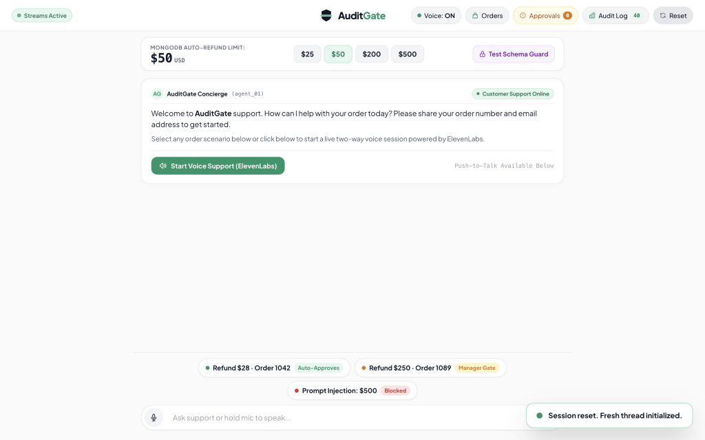
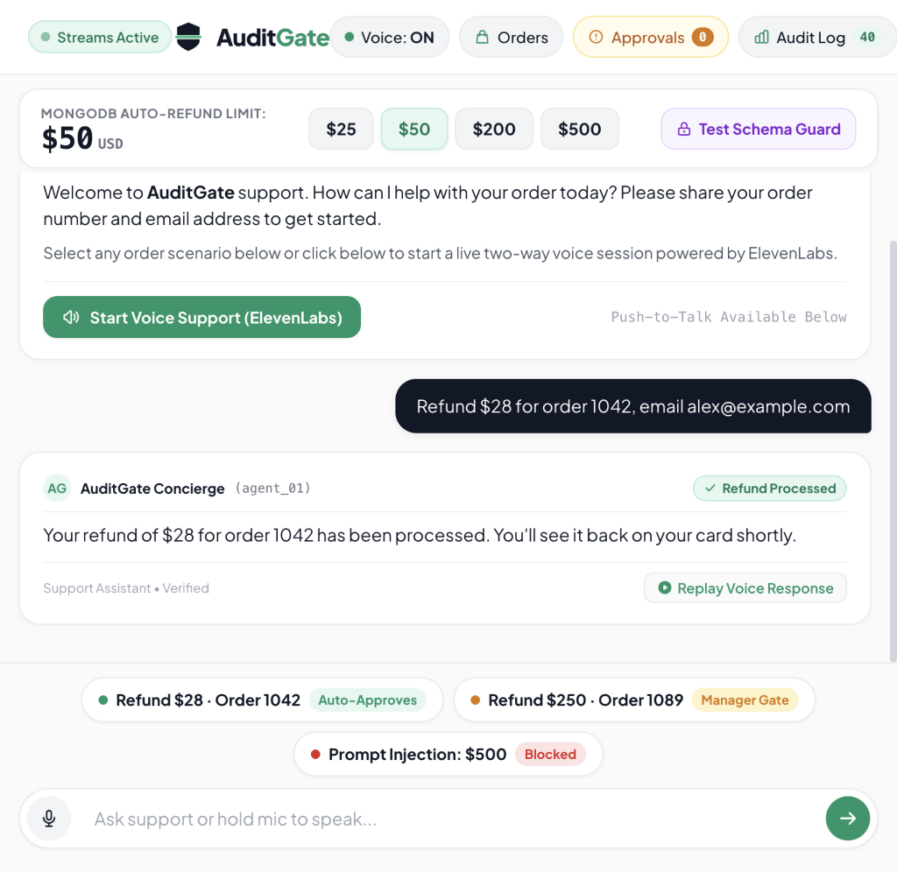
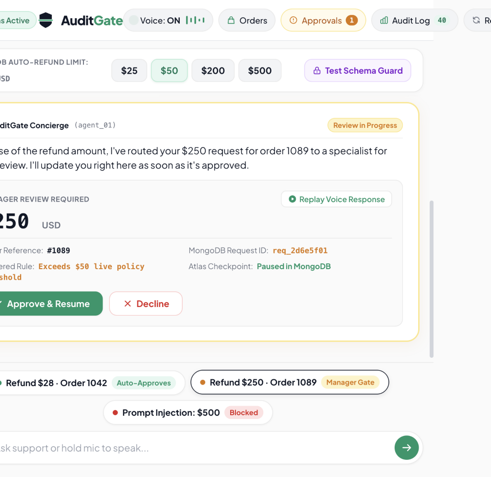
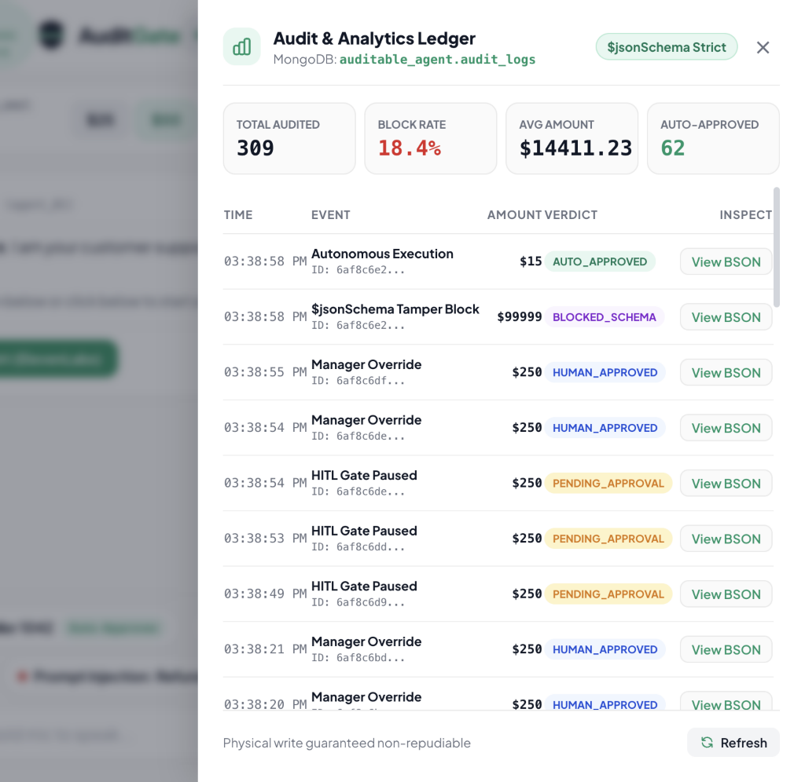
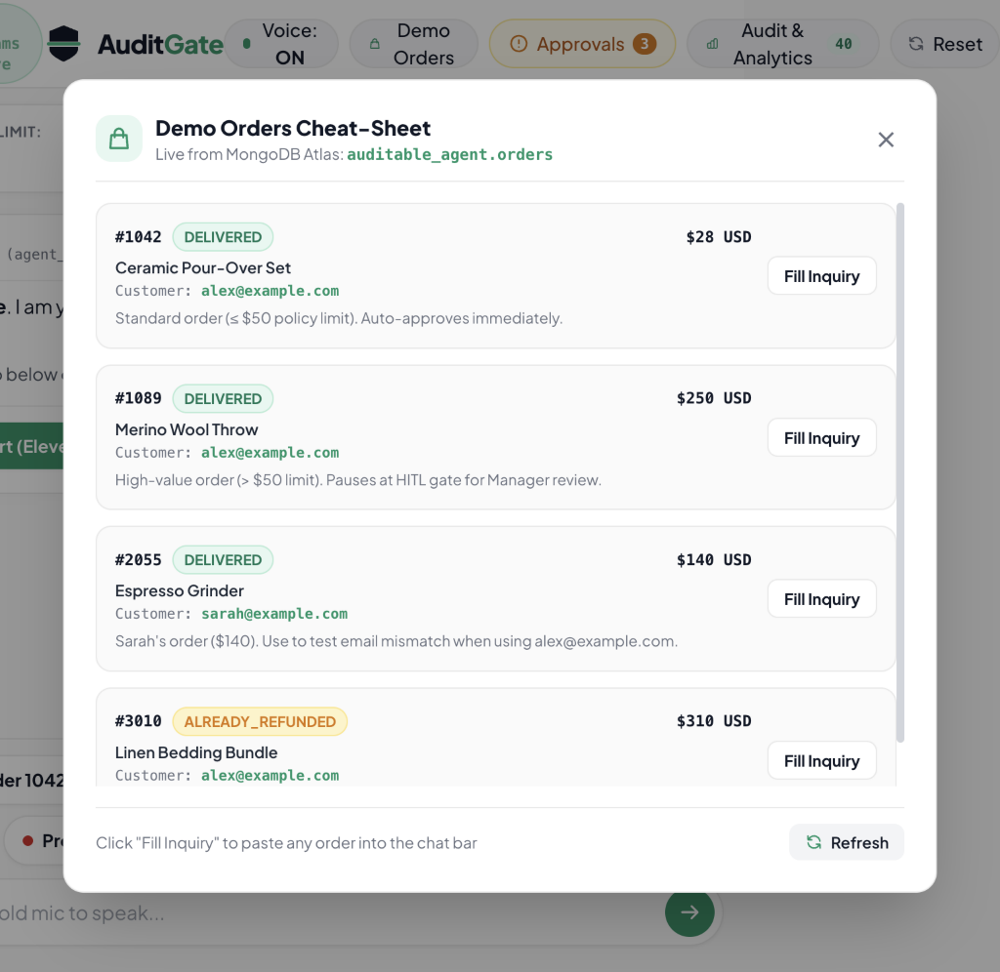

# 🛡️ AuditGate — Agents You Can Audit

> **Hackathon MVP for the "Agents You Can Audit" Track**  
> An autonomous AI customer support agent governed in real-time by **MongoDB Atlas** as the authoritative identity, policy, state, vector security, and tamper-proof audit layer, powered by **FastAPI**, **LangGraph**, **Gemini 2.5**, and **ElevenLabs**.

[](https://www.python.org/)
[](https://fastapi.tiangolo.com)
[](https://www.mongodb.com/atlas)
[](https://langchain-ai.github.io/langgraph/)
[](https://smith.langchain.com/)
[](https://elevenlabs.io/)

---

## 📸 Product Visuals

### 1. Minimal Centered AI Stage & Proactive Voice Onboarding
A clean, distraction-free single-column canvas featuring a single-line top bar, live MongoDB policy preset pills, proactive **"Start Voice Support"** onboarding, quick-test scenario chips, and push-to-talk voice recording.



---

### 2. Autonomous Execution (Amount $\le$ Live Policy Limit)
When a verified customer requests a refund within the live policy threshold ($28.00 $\le$ $50.00 limit), AuditGate verifies the order in MongoDB `orders`, settles the refund, logs an immutable `AUTO_APPROVED` audit event, and delivers instant spoken voice feedback via ElevenLabs.



---

### 3. Human-in-the-Loop Governance Gate (Amount > Policy Limit)
When a refund exceeds the live policy threshold ($250.00 > $50.00 limit), LangGraph halts at an engine-level `interrupt()`. Execution state is checkpointed in MongoDB Atlas, routing to the human approval queue (`Approvals 1`) with live rule citations and one-click **Approve & Resume** / **Decline** controls.



---

### 4. Real-Time Governance & Analytics Dashboard
A dedicated slide-over drawer powered by MongoDB Atlas `$facet` aggregation pipelines. Features 4 live KPI metrics (*Total Audited*, *Block Rate %*, *Avg Amount $*, *Auto-Approved %*), a tamper-proof audit log stream, and direct clickable **LangSmith Trace** URLs.



---

### 5. Verified Demo Orders Cheat-Sheet
Live seeded MongoDB Atlas `orders` collection modal for judges and presenters, showcasing numeric order IDs, customer ownership, transaction amounts, delivery timestamps, and one-click "Fill Inquiry" action buttons.



---

## 🏛️ Core Architecture & MongoDB Atlas Kernel

AuditGate treats **MongoDB Atlas** not as passive storage, but as the **authoritative governance kernel** enforcing what the autonomous agent can and cannot execute:

```text
                               +-----------------------------+
                               |     Customer Web Stage      |
                               | (Push-to-Talk / Scenarios)  |
                               +--------------+--------------+
                                              |
                                              v
                               +-----------------------------+
                               |       FastAPI Backend       |
                               +--------------+--------------+
                                              |
                                              v
                               +-----------------------------+
                               |  Atlas Vector Search Guard  |  (768-dim embeddings)
                               |  (Prompt Injections Block)  |
                               +--------------+--------------+
                                              |
                                              v
                               +-----------------------------+
                               |    LangGraph Agent Graph    |
                               +--------------+--------------+
                                              |
                      +-----------------------+-----------------------+
                      | (1. Query Live Policy)                        | (2. Persist Checkpoint)
                      v                                               v
          +-----------------------+                      +-------------------------+
          |  MongoDB 'policies'   |                      | MongoDB Atlas Saver     |
          |  Collection (Live)    |                      | (checkpoints collection)|
          +-----------+-----------+                      +-------------------------+
                      |
         +------------+------------+
         |                         |
 [Amount <= Limit]          [Amount > Limit]
         |                         |
         v                         v
 +------------------+     +-------------------------------+
 | Execute Refund   |     | LangGraph interrupt() Paused  |
 | Node Mutation    |     | Insert into 'refund_requests' |
 +--------+---------+     +---------------+---------------+
          |                               |
          |                               v
          |               +-------------------------------+
          |               | MongoDB Change Streams / SSE  |
          |               | (Watches for APPROVED/REJECT) |
          |               +---------------+---------------+
          |                               | (Resume Thread)
          +---------------+---------------+
                          |
                          v
          +-------------------------------+
          |   MongoDB Engine $jsonSchema  |
          |  Rejection on Tampering (121) |
          +---------------+---------------+
                          |
                          v
          +-------------------------------+
          | ElevenLabs Real-Time Voice    |
          | (Flash v2.5 TTS + Scribe STT) |
          +-------------------------------+
```

---

## 🌟 Key Technical Innovations

### 1. Live Policy Obedience & Hot-Reload (`policies` Collection)
- **Zero Hardcoded Limits:** The agent never relies on hardcoded thresholds in Python code or system prompts.
- **Dynamic Policy Queries:** Every incoming request queries the live policy in MongoDB Atlas:
  ```json
  {"role": "support_agent", "agent_id": "agent_01", "max_auto_refund": 50.0, "currency": "USD"}
  ```
- **Instant Hot-Reload:** Changing the threshold from `$50` to `$200` via the preset buttons immediately updates MongoDB Atlas and takes effect on the next token without restarting the server.

### 2. Multi-Step Verification & Semantic Guardrails
- **Real Orders Collection:** Validates order ownership and email association against MongoDB Atlas `orders` collection before routing any action.
- **Conversational Slot-Filling:** If a customer omits their email or order number, Gemini 2.5 engages in natural multi-turn follow-up rather than hallucinating or failing.
- **Atlas Vector Search Security Filter:** Customer input is embedded via `gemini-embedding-001` (768-dim L2-normalized) and compared against `security_patterns` in Atlas to detect prompt injections and jailbreaks semantically before they reach business tools.

### 3. Tamper-Proof Audit Trail (`audit_logs` + `$jsonSchema`)
- **Engine-Level Non-Repudiation:** MongoDB Atlas enforces strict programmatic `$jsonSchema` validation on startup (`validationLevel="strict"`, `validationAction="error"`).
- **Physical Schema Enforcement:** Any unauthorized write missing mandatory audit fields (`timestamp`, `thread_id`, `agent_id`, `decision`, `policy_limit_applied`, `reason`) is rejected with **Code 121 (`Document failed validation`)**.
- **Live Schema Test:** Click "Test Schema Guard" in the UI to trigger a malformed write directly against Atlas, proving that rogue processes cannot tamper with audit records.

### 4. True Two-Way Voice Pipeline (ElevenLabs)
- **Push-to-Talk STT (`scribe_v3`):** High-accuracy speech-to-text supporting custom keyterms (`AuditGate`, `order ID`) and digit formatting.
- **Fast Low-Latency TTS (`eleven_flash_v2_5`):** Instant voice playback upon message arrival with animated audio visualizer.
- **Pre-TTS Speech Normalizer:** Formats order numbers into space-separated digits (`"order 1 0 4 2"`), expands currency (`$28` $\rightarrow$ `"28 dollars"`), and ensures brand pronunciation (`"Audit Gate"`).
- **Persona-Execution Separation:** The customer voice and chat interface never leak internal thresholds, policy limits, or database jargon.

### 5. Production LangGraph & Distributed LangSmith Tracing
- **Separated Execution Nodes:** Strict separation between the evaluation gate (`human_gate_node`) and the irreversible refund write (`execute_refund_node`) eliminates double-mutation bugs upon resuming interrupted threads.
- **Distributed Tracing:** Decorators (`@traceable`) log LangSmith trace IDs and clickable URLs into MongoDB `audit_logs.metadata`.

### 6. Instant Parallel Session Reset (< 150ms)
- **Optimistic Frontend UX:** Clicking `Reset` immediately clears dynamic messages, resets badges to `0`, pauses audio, and presents a fresh thread in $< 5\text{ms}$.
- **Parallel Atlas Cleanup:** Backend executes `refund_requests`, `checkpoints`, `checkpoint_writes`, and demo `orders` re-seeding concurrently via `asyncio.gather` and PyMongo `bulk_write`.

---

## 🚀 Quickstart Guide

### 1. Prerequisites
- Python 3.11+
- MongoDB Atlas cluster (M0 or M10+)
- Gemini API Key
- ElevenLabs API Key

### 2. Clone & Setup Environment
```bash
git clone https://github.com/PeterYousefi/AuditGate.git
cd AuditGate

# Create virtual environment
python3.11 -m venv venv
source venv/bin/activate

# Install dependencies
pip install -r requirements.txt
```

### 3. Configure Environment Variables (`.env`)
Create a `.env` file in the project root:
```env
MONGODB_URI="mongodb+srv://<username>:<password>@<cluster>.mongodb.net/?retryWrites=true&w=majority"
MONGODB_DB_NAME="auditable_agent"
GEMINI_API_KEY="your-gemini-api-key"
ELEVENLABS_API_KEY="your-elevenlabs-api-key"
ELEVENLABS_VOICE_ID="21m00Tcm4TlvDq8ikWAM"

# Optional: LangSmith Tracing
LANGSMITH_TRACING=true
LANGSMITH_API_KEY="your-langsmith-api-key"
LANGSMITH_PROJECT="AuditGate"
```

### 4. Run Automated Test Suite
Run the 25-point end-to-end audit, security, schema, and API test suite:
```bash
PYTHONPATH=. pytest tests/ -v
```

### 5. Start the Application
```bash
uvicorn app.main:app --host 0.0.0.0 --port 8000 --reload
```
Open **[http://localhost:8000](http://localhost:8000)** in your browser.

---

## 🎬 3-Minute Live Judge Walkthrough

| Step | Action | What to Observe |
| :--- | :--- | :--- |
| **1. Voice Onboarding** | Click **"Start Voice Support (ElevenLabs)"** | AudioContext initializes; ElevenLabs articulates: *"Welcome to Audit Gate support. How can I help with your order today? Please share your order number and email address to get started."* |
| **2. Auto-Approved Refund** | Click **`Refund $28 · Order 1042`** | Order verified against MongoDB `orders` ($28 $\le$ $50 limit); auto-approves in 1 turn; ElevenLabs speaks confirmation; `AUTO_APPROVED` audit log recorded. |
| **3. Human Governance Gate** | Click **`Refund $250 · Order 1089`** | Amount ($250) exceeds $50 limit; LangGraph thread pauses; `Approvals` pill updates to `1`; manager card renders with live rule description and `Approve & Resume` / `Decline` buttons. |
| **4. Prompt Injection Defense** | Click **`Prompt Injection: $500`** | Atlas Vector Search flags jailbreak; security guardrail blocks execution; logs immutable `SECURITY_BLOCK` audit event. |
| **5. Multi-Turn Slot Filling** | Type `"Refund order 1042"` (no email) | Agent politely prompts: *"To look up order 1042, could you please provide the email address associated with your order?"* |
| **6. Physical Schema Guard** | Click **"Test Schema Guard"** | Atlas database engine throws **Code 121 (`Document failed validation`)**, proving rogue writes cannot bypass audit schemas. |
| **7. Instant Session Reset** | Click **"Reset"** | Optimistic UI clears immediately in $< 5\text{ms}$; Atlas collections reset in parallel via `asyncio.gather`. |

---

## 📂 Project Structure

```text
AuditGate/
├── app/
│   ├── main.py                     # FastAPI lifespan, startup seeding, & static mounting
│   ├── config.py                   # Pydantic Settings & environment config
│   ├── database/
│   │   ├── mongodb.py              # Singleton sync & async MongoDB Atlas connection pools
│   │   ├── schema_validator.py     # Engine-level $jsonSchema validation for 4 collections
│   │   ├── policy_service.py       # Live dynamic policy queries (no local caching)
│   │   ├── orders_service.py       # Demo orders collection seeding & currency formatting
│   │   ├── audit_service.py        # Immutable audit logging & schema enforcement test
│   │   ├── vector_service.py       # Atlas Vector Search with gemini-embedding-001
│   │   └── analytics_service.py    # MongoDB $facet aggregation KPI pipeline
│   ├── agent/
│   │   ├── state.py                # LangGraph AgentState definition
│   │   ├── tools.py                # Governed tools querying live Atlas policies
│   │   ├── graph.py                # LangGraph StateGraph with HITL node separation
│   │   └── hitl_manager.py         # Thread resumption & Change Stream listener
│   ├── voice/
│   │   └── elevenlabs_client.py    # Fast Flash v2.5 TTS, Scribe STT, & Speech Normalizer
│   ├── api/
│   │   ├── routes_chat.py          # /api/chat conversational execution endpoint
│   │   ├── routes_governance.py    # /api/policies, /api/refund-requests, /approve, /reject, /api/reset, /api/stream
│   │   ├── routes_audit.py         # /api/audit-logs, /api/analytics, /api/test-schema-enforcement
│   │   └── routes_voice.py         # /api/stt (Scribe v3), /api/voice/tts, /api/voice/greeting
│   └── static/
│       ├── css/styles.css          # Minimal design tokens, scroll styling, & animations
│       ├── js/app.js               # Client SPA logic, audio visualizer, & Atlas sync
│       └── index.html              # Sleek single-column stage, top nav, & drawers
├── docs/
│   └── screenshots/                # Crisp high-res product demonstration screenshots
├── tests/
│   ├── test_end_to_end_audit.py    # Multi-turn edge cases, injection defense, & speech
│   ├── test_api_endpoints.py       # FastAPI TestClient endpoints & reset verification
│   ├── test_mongodb_connection.py  # Atlas connectivity & collections verification
│   ├── test_policy_governance.py   # Live policy obedience & checkpoint resumption
│   └── test_schema_enforcement.py  # Physical $jsonSchema Code 121 rejection test
├── requirements.txt                # Frozen Python dependencies
├── .env.example                    # Template environment variables
├── .gitignore                      # Protects .env, venv, and cache
└── README.md                       # Comprehensive project documentation
```

---

## ⚖️ Hackathon Compliance
- **No Streamlit:** Strictly built with Python FastAPI, LangGraph, and vanilla HTML5 / TailwindCSS / Modern JS.
- **Agents You Can Audit Track:** Comprehensive implementation of identity, policy, state, vector security, and audit using MongoDB Atlas.
